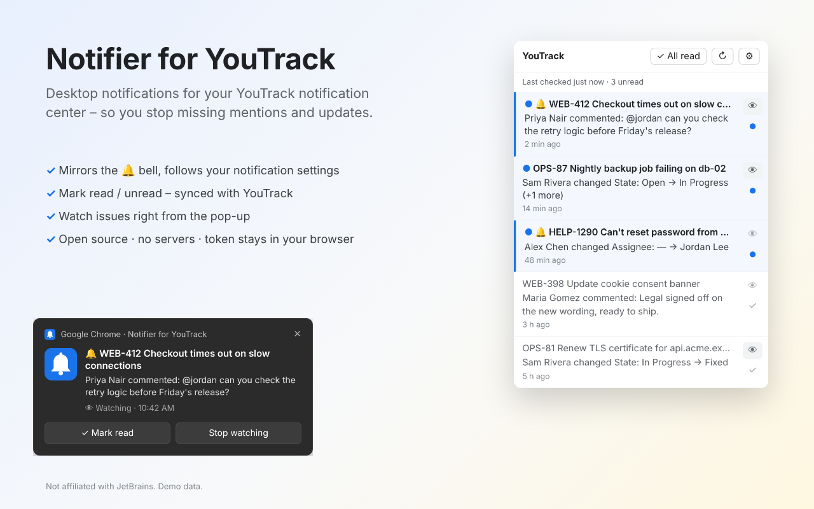
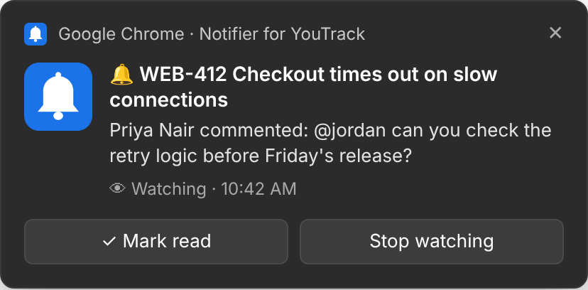
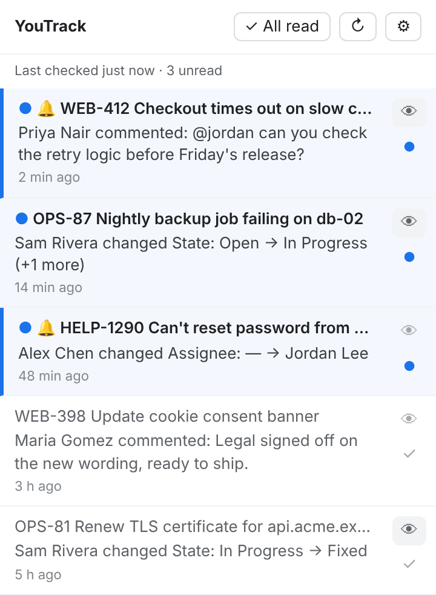
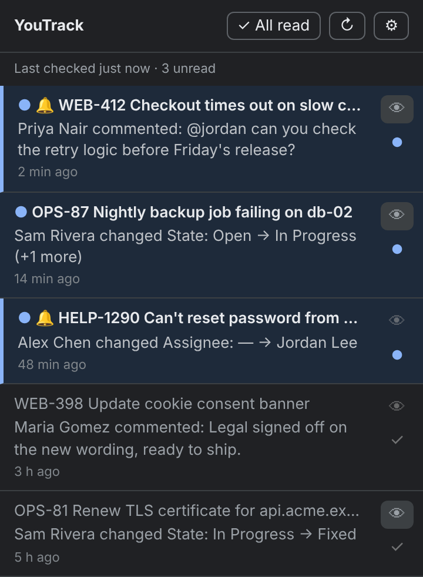
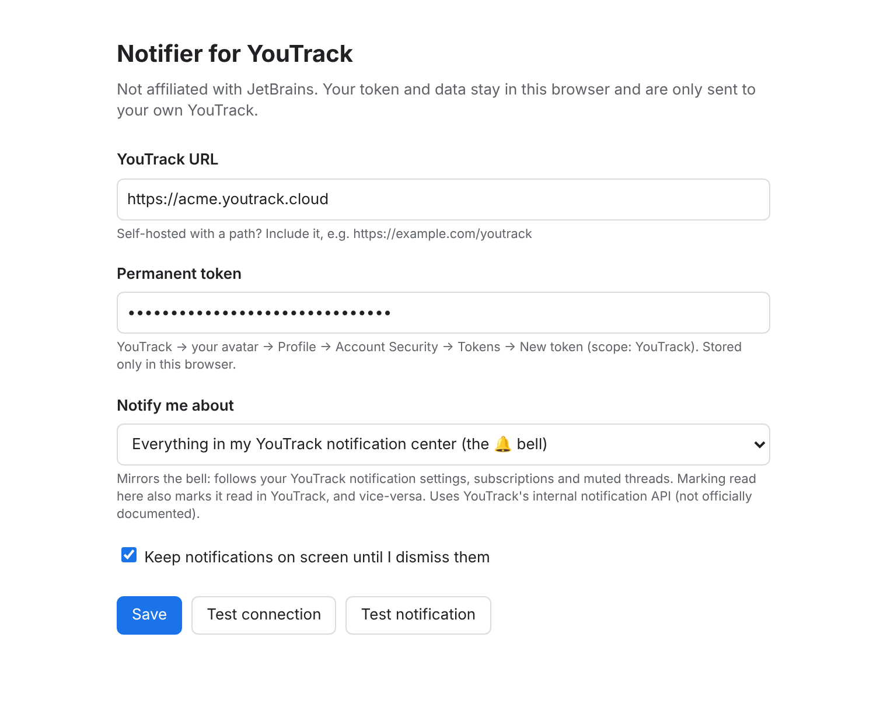

# Notifier for YouTrack

Desktop notifications for [YouTrack](https://www.jetbrains.com/youtrack/) – a Chrome extension that turns your
YouTrack notification center (the 🔔 bell) into native browser notifications, with **Mark read** and **Watch**
buttons right on the pop-up.

YouTrack has no built-in browser/desktop notifications; this is the long-standing feature request
[JT-63563 – An option to get push notifications from the browser](https://youtrack.jetbrains.com/issue/JT-63563).
This extension fills that gap until JetBrains ships it.

> Not affiliated with or endorsed by JetBrains. YouTrack is a trademark of JetBrains s.r.o.



## Features

- **Mirrors the 🔔 bell.** Follows your YouTrack notification settings, subscriptions and muted threads.
- **Mentions & reactions stand out** – marked 🔔 and kept on screen until you dismiss them.
- **Two-way read sync.** Mark read (or unread) in the extension and the bell updates; read something in YouTrack
  and the pop-up closes and the badge updates.
- **Watch / Stop watching** button (YouTrack's "Star") on every notification and in the list.
- **Toolbar badge** with the unread count, and a popup list of recent items with read/unread and watch toggles.
- **Grouped updates** – several changes on one issue become one pop-up ("+2 more").
- **Opens links where you want them** – reuse an open YouTrack tab (default), a new tab, or a new window.
- **Follows your system light/dark theme.**
- **Fallback mode:** watch activity on issues matching any YouTrack search query (documented API only).
- No servers, no analytics: the extension talks only to your YouTrack instance. See [PRIVACY.md](PRIVACY.md).

Works with YouTrack Cloud. Self-hosted YouTrack Server should work on versions that have the new notification
center; older servers can use the activity-query mode.

## Screenshots

| Notification | Popup (light) | Popup (dark) |
|---|---|---|
|  |  |  |

Notification appearance depends on your operating system. Settings page:



_All screenshots use made-up demo data._

## Install

**From a release (recommended for now)**

1. Download `notifier-for-youtrack-<version>.zip` from [Releases](../../releases) and unzip it somewhere permanent.
2. Open `chrome://extensions`, switch on **Developer mode** (top right).
3. Click **Load unpacked** and select the unzipped folder.

**From source:** clone the repo and **Load unpacked** the `extension/` folder.

Works in Chrome and other Chromium browsers (Edge, Brave, Vivaldi).

## Set up

1. The Options page opens on install (or right-click the toolbar icon → *Options*).
2. **YouTrack URL** – e.g. `https://yourcompany.youtrack.cloud`. Self-hosted with a path? Include it
   (`https://example.com/youtrack`).
3. **Permanent token** – in YouTrack: avatar → *Profile* → *Account Security* → *Tokens* → **New token**,
   scope *YouTrack*. Paste the `perm:…` value.
4. **Notify me about** – *Notification center* (default) or *Activity on issues matching a search query*.
5. Click **Save**, allow access to your YouTrack host when Chrome asks, then **Test connection** and
   **Test notification**.

On first run, unread items already in your bell show up in the list without popping up; only new ones pop up.

## Notifications not appearing?

If **Test notification** shows nothing, it's almost always the operating system:

- **Windows:** Settings → System → Notifications → Google Chrome on; Focus / Do Not Disturb off.
- **macOS:** System Settings → Notifications → Google Chrome → Allow, style *Alerts* (so they stay).
  Notification buttons appear under **Options** or on hover.
- **Ubuntu / GNOME:** Settings → Notifications → Do Not Disturb off, Google Chrome on.

Chrome has to be running (it can be in the background). The fastest check interval is 30 seconds (a Chrome limit).

## How it works

| | Notification center mode (default) | Activity-query mode |
|---|---|---|
| Source | `GET /api/inbox/threads` (folders: default + `direct`) | `GET /api/activities?issueQuery=…` |
| Follows your YouTrack notification settings | Yes | No – uses your query |
| Read state synced with the bell | Yes – `POST /api/inbox/markMessages` | No – local only |
| API status | **Undocumented** – the same calls YouTrack's web UI makes | Documented REST API |

Watch uses `POST /api/issues/{id}/watchers` (`{"hasStar": true}`), the same call as the star icon in YouTrack,
with the `star <login>` command as a fallback.

**About the undocumented API:** the notification-center mode uses YouTrack's internal `/api/inbox` endpoints
because there's no public API for the bell. A YouTrack update could change them. If the detailed request is
rejected the extension retries with a minimal field set; any error shows as a red **!** on the toolbar icon
and in the popup. If that happens, please [open an issue](../../issues) – or switch to activity-query mode.

### Helpdesk projects

Watch works on helpdesk tickets, but YouTrack's helpdesk view doesn't display the star. Open the ticket in the
regular issue view to see it.

## Project layout

```
extension/              the extension itself (load this folder unpacked)
  manifest.json         Manifest V3
  background.js         service worker: polling alarm, notification buttons, messages
  inbox.js              notification-center mode (/api/inbox)
  lib.js                settings, activity-query mode, badge, read/watch actions
  options.html/.js      settings page
  popup.html/.js        toolbar popup
  style.css             shared styles (light/dark)
scripts/package.sh      builds dist/notifier-for-youtrack-<version>.zip (manifest at zip root)
.github/workflows/      check on push/PR; build + GitHub release on tag
```

No build step and no dependencies – plain JavaScript modules.

## Releasing

1. Bump `version` in `extension/manifest.json` and add an entry to [CHANGELOG.md](CHANGELOG.md).
2. Commit, then tag and push: `git tag v1.4.1 && git push --tags`.
3. The *Release* workflow checks the tag matches the manifest, builds the zip and attaches it to a GitHub release.

To build locally: `bash scripts/package.sh`.

## Contributing

Issues and pull requests are welcome. Especially useful:

- Reports from **self-hosted YouTrack Server** (which version works, which doesn't).
- Notification text that looks wrong or generic – include what the bell showed vs. what the pop-up said
  (please redact customer data).
- If a YouTrack update breaks notification-center mode: the request URL and a **redacted** response from
  DevTools → Network for the `threads?` request the bell makes. Never post your `Authorization` header.

## License

[MIT](LICENSE)
